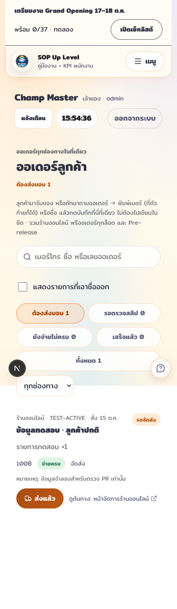
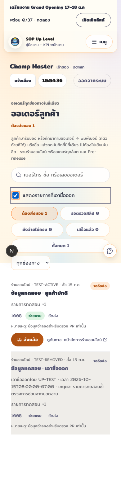
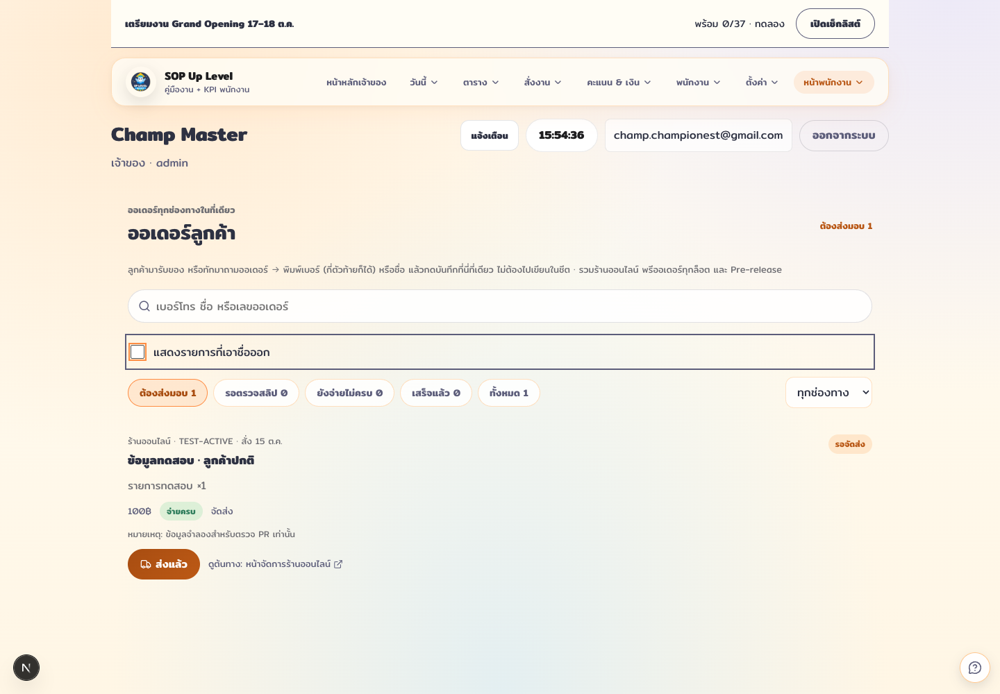
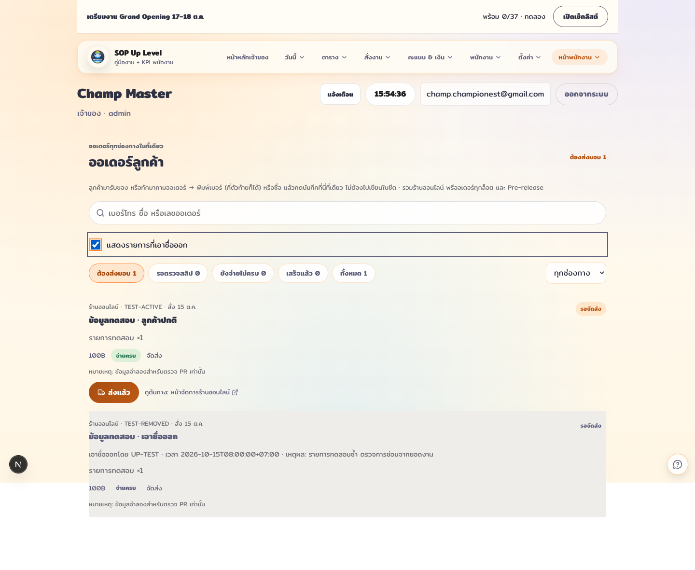
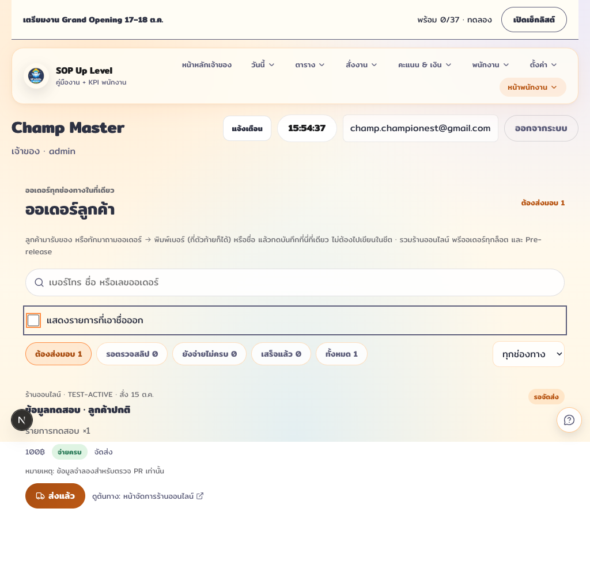
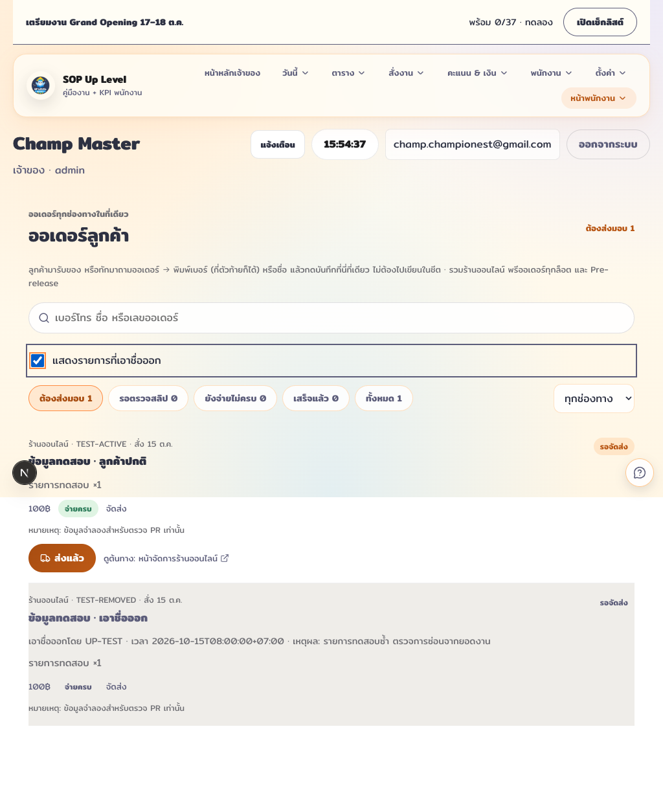

# GB soft-removal audit

## Read inventory

Searched `app/`, `components/`, and `lib/` for every collection in the current
`~/Projects/line-ops-bot/lineops/datamap.py:SOURCES`, plus `users` and
`public_payments`, and traced shared server readers to their callers.

| Reader / source | Affected views / consumers | Behavior |
| --- | --- | --- |
| `customer-orders-server.ts`: `shop-orders`, `set14-reservations`, `bundle-reservations`, `prerelease-reservations` | `/orders`, home OrdersTodoCard, `/api/customer-orders`, owner app API integration | Default feed excludes removed; staff list can opt in with `showRemoved=1`; counts always active only. Cached full feed is filtered separately for each caller. |
| `customer-orders-server.ts`: `delivery_tasks` | Order fulfillment status on `/orders` | Removed tasks never supply fulfillment status. |
| `delivery-tasks-server.ts`: `shop-orders`, `delivery_tasks` | DeliveryOrdersBoard on staff/owner home, `/api/delivery-tasks`, Admin Hub notifications, staff notifications | Filter tasks and source orders before returning/counting; audit toggle on board. Existing tasks of removed orders are hidden too. Removed tasks stay in deduplication set and cannot be recreated by sync. |
| `admin-notifications-server.ts`: `users`, `coin_topups`, `shop_orders`, also `activity_claims`, `quest_submissions`, `shop_requests`, `merge_requests` | Admin Hub guild pending-work counts | Status query projects only `removed`, filters locally before count; no slip/customer fields downloaded. These views link out to guild and have no local row list. |

Other GB collections have no document reader in this application. Grand Opening
checklist reads `sop_grand_opening_checklist`, not `go-orders`/`go-reservations`.
MA6/Lorcana 13/Mega Tactic order rows come from Google Sheets; there is no Firestore
record mapping in this app, so those sheet rows are unchanged. There are no local
GB event seat/check-in/export readers. No rules, migrations, deletes, membership
semantics, payment state changes, public signup changes, or new indexes.

## QA

- `npm run lint`: passed.
- `npm test`: passed: 929 tests, 0 failures/skips.
- `npm run build`: passed.
- Shared toggle tests cover on/off events, accessible label, escaped audit text.
- Server tests cover default filtering, cached opt-in isolation, restore, delivery
  parent removal, and no recreation of removed delivery tasks.
- Browser: `/orders` with `orders-fixture.json` mocked through agent-browser network
  routing, no database writes. Mock deliberately supplies removed records even on
  the default response to exercise the browser's defensive filter.
- 390×844, 1440×1000, 1024×768: toggle off/on; no horizontal document overflow;
  active totals stay at 1; removed row is muted, has audit metadata, no actions;
  Space toggles the focused checkbox.
- `/admin?branch=senafest`: delivery toggle shows removed audit row, keeps headline at zero pending, hides action buttons, and hides row again on off.
- Self-review: diff/security and interface-guidelines review passed for added code; Impeccable detector returned no findings. Existing app shell styles remain unchanged. The retired shared a11y-check script is absent, so keyboard, target size, overflow and computed colors were checked directly.
- Images are synthetic QA data, not customer records. Off/on images below.

| Viewport | Off (default) | On |
| --- | --- | --- |
| Mobile |  |  |
| Desktop |  |  |
| Tablet |  |  |

## Limits

Existing customer-order cache TTL is 30 seconds; browser polling is 60 seconds.
The toggle is intentionally reset to off on a fresh page load. Existing list
status/channel filters still apply while showing removed rows. Notification
queries now cost document reads for matching pending records, rather than an
aggregate count, to keep documents missing `removed` included without indexes.
